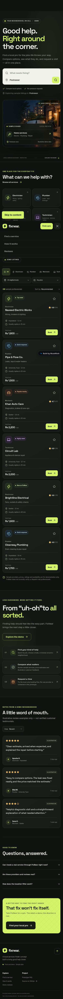

# FixNear — Local Services Finder

**A React prototype for discovering nearby electricians, plumbers, mechanics, and technicians.** Search example listings, filter by service and neighborhood, compare illustrative prices and reviews, and try a booking request that stays in your browser.

> **Prototype notice:** FixNear is a front-end demo, not a live marketplace. Providers, prices, ratings, reviews, neighborhoods, and availability are illustrative sample data. Demo booking requests are saved locally in the browser and are not sent to real professionals.


## Why FixNear?

Finding a dependable person for a home repair can take more work than the repair itself. FixNear explores a simpler local-services discovery flow: browse common trades, narrow listings by neighborhood or budget, compare sample provider cards, and see how a booking request could feel.

## Features

- **Service discovery:** sample listings for electricians, plumbers, mechanics, and technicians.
- **Search and filters:** search by trade, provider, service detail, or neighborhood; combine category, neighborhood, and maximum-price filters.
- **Sorting:** order the sample listings by recommendation, illustrative rating, or visit price.
- **Booking-flow prototype:** accessible dialog with labeled fields and validation; requests are stored in `localStorage` only.
- **Review examples:** clearly labeled illustrative review snippets with a recent/top-rated view.
- **Responsive interface:** keyboard-friendly navigation, visible focus states, reduced-motion support, and layouts for phones through desktop.
- **SEO-ready page metadata:** descriptive title and summary plus Open Graph and social preview metadata.

## Screenshots

The generated hero visual is included at `public/fixnear-hero.png`. The screenshot below shows the responsive mobile view. Run the app locally to explore the interactive provider listings, filters, and demo booking dialog.



## Tech stack

- React 19
- Vite 8
- Lucide React icons
- CSS design tokens and responsive styles

## Run locally

Requires Node.js 20.19+ or 22.12+ and npm.

```bash
git clone https://github.com/Zabeeh-Ullah-Dev/FixNear.git
cd FixNear
npm install
npm run dev
```

Open the local URL printed by Vite. To make and preview an optimized production build:

```bash
npm run build
npm run preview
```

## Project structure

```text
FixNear/
├── doc/design.md          # Visual and interaction specification
├── public/                # Original hero art and icons
├── src/App.jsx            # React UI and demo interactions
├── src/index.css          # Responsive design system
├── src/main.jsx           # React entry point
├── index.html             # SEO and social metadata
├── package.json
└── vite.config.js       # Vite + React plugin, base '/FixNear/' for GitHub Pages
```

## Demo data and privacy

This prototype does not use a server, payment processor, live geolocation, mapping service, authentication, SMS, or email delivery. Example listings and review content are not endorsements and are not verified. If you submit the demo booking form, the sample request is stored in your browser’s `localStorage`; it is not transmitted to FixNear or a service provider.

## Accessibility notes

The interface includes semantic page regions, a skip link, labeled controls, keyboard-visible focus, an accessible booking dialog, form constraints, touch-friendly controls, and reduced-motion handling. Accessibility should still be checked with assistive technology before production use.

## License

Distributed under the MIT License. See [LICENSE](LICENSE).

## About

Built by [Zabeeh Ullah](https://github.com/Zabeeh-Ullah-Dev) as a portfolio project exploring local service discovery and responsive React interface design. If you find a bug or have a constructive improvement, please open an issue or pull request.

---

**Relevant topics:** local-services-finder · home-services · react · vite · service-marketplace · responsive-design
